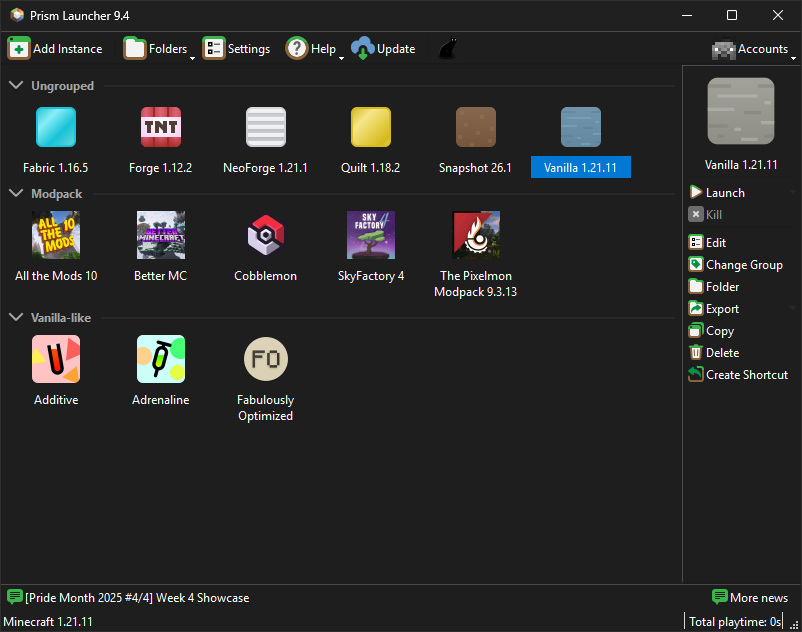
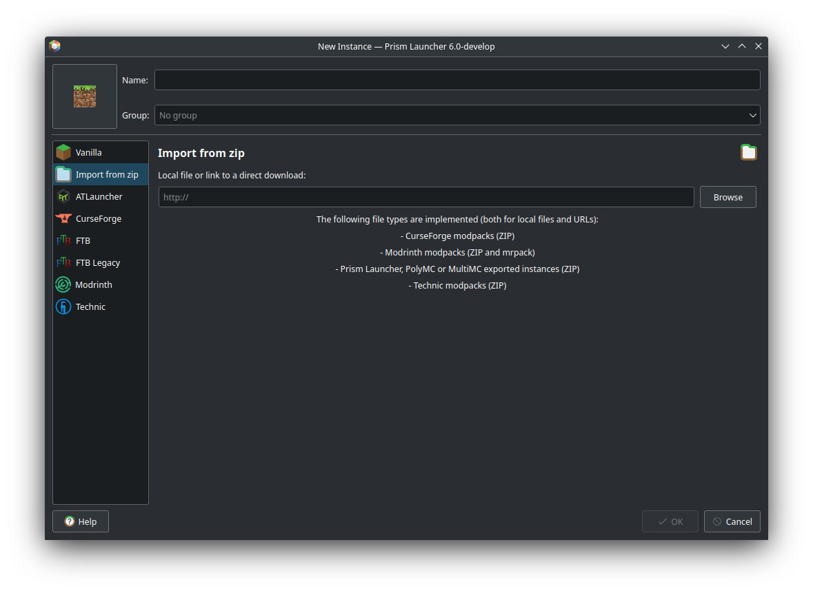
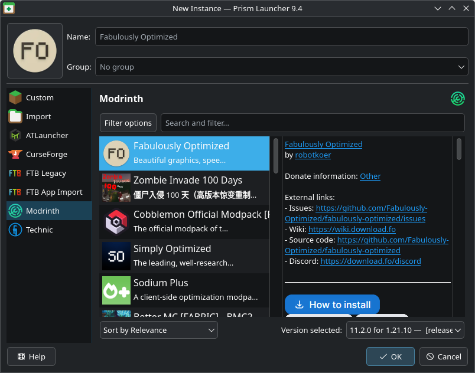

# Tutorial do Prism Launcher

Instale o Prism Launcher, conecte sua conta do Minecraft e importe o modpack da Arca. No Prism, uma **instância** é uma instalação separada do jogo, com seus próprios mods, configurações e mundos.

## Instalar o Prism Launcher

- **Windows** — Na [página oficial para Windows](https://prismlauncher.org/download/windows/), escolha **Installer (.exe)** na opção **x86-64** para PCs com processador Intel ou AMD. Em um PC Windows com processador ARM, escolha **ARM64**. Abra o instalador, avance até concluir e inicie o Prism Launcher pelo menu Iniciar.
- **macOS** — Na [página oficial para macOS](https://prismlauncher.org/download/macos/), baixe o arquivo **Universal (.zip)**, abra-o e arraste o Prism Launcher para **Aplicativos**. Depois, abra o aplicativo por essa pasta.
- **Linux** — Na [página oficial para Linux](https://prismlauncher.org/download/linux/), escolha o pacote para sua distribuição. Se você usa Flatpak, abra o link **Flathub** e instale por lá.

Na primeira abertura, selecione **Português (Brasil)** no assistente, se preferir. Os nomes em inglês aparecem entre parênteses para ajudar a localizar os controles mostrados nas capturas.

## Configurar a conta e o Java

No canto superior direito, abra **Contas (Accounts)**. Selecione **Gerenciar contas (Manage Accounts)** e clique em **Adicionar Microsoft (Add Microsoft)**. Siga as instruções que aparecerem para entrar com a conta que tem acesso ao **Minecraft: Java Edition**. Ao terminar, volte ao launcher e confirme que seu perfil aparece em **Contas**.

Em **Configurações (Settings)**, abra **Java**. Quando as opções estiverem disponíveis, ative a detecção automática da versão do Java e o download automático do Java da Mojang. Assim, o launcher escolhe a versão certa ao abrir a instância.

Se precisar instalar manualmente, escolha o **Java 21**, que é a versão usada pelo modpack da Arca. Depois de instalar, volte a **Configurações (Settings) > Java** e selecione o Java 21. Consulte as [instruções oficiais para instalar o Java manualmente](https://prismlauncher.org/wiki/getting-started/installing-java/).

## Importar o modpack da Arca

[Baixar a instância da Arca no Google Drive](https://drive.google.com/file/d/1J13UE0RvnY1H8m1GjAq9-3mR5QuhRMaT/view?usp=sharing)

Mantenha o arquivo `.zip` intacto para importá-lo no Prism Launcher.

- Na janela principal, clique em **Adicionar instância (Add Instance)**, no canto superior esquerdo.
- No menu à esquerda, selecione **Importar (Import)**. Em versões anteriores, a opção aparece como **Import from zip**, como na captura abaixo.
- Clique em **Procurar (Browse)** e selecione o arquivo do pack. Dê um nome à instância, como **Arca**, confirme com **OK** e aguarde o término da importação.

## Instalar o Cobbleverse pelo Modrinth

Para jogar o Cobbleverse base, abra **Adicionar instância (Add Instance)** e selecione **Modrinth** no menu à esquerda. Pesquise por **COBBLEVERSE** e escolha o projeto da **LUMYVERSE**. Selecione a versão no campo inferior e confirme com **OK**. Para jogar na Arca, use a versão indicada pela equipe, com os mods e as configurações do servidor. [Página oficial do Cobbleverse no Modrinth](https://modrinth.com/modpack/cobbleverse).

Capturas de tela dos colaboradores do Prism Launcher, disponíveis no [site oficial](https://prismlauncher.org/) e na [documentação de importação](https://prismlauncher.org/wiki/help-pages/Zip-import/). Clique nas imagens para ampliar.

Link do Prism launcher ladrão: [Tio do Vein](https://drive.google.com/file/d/1J13UE0RvnY1H8m1GjAq9-3mR5QuhRMaT/view?usp=sharing)
